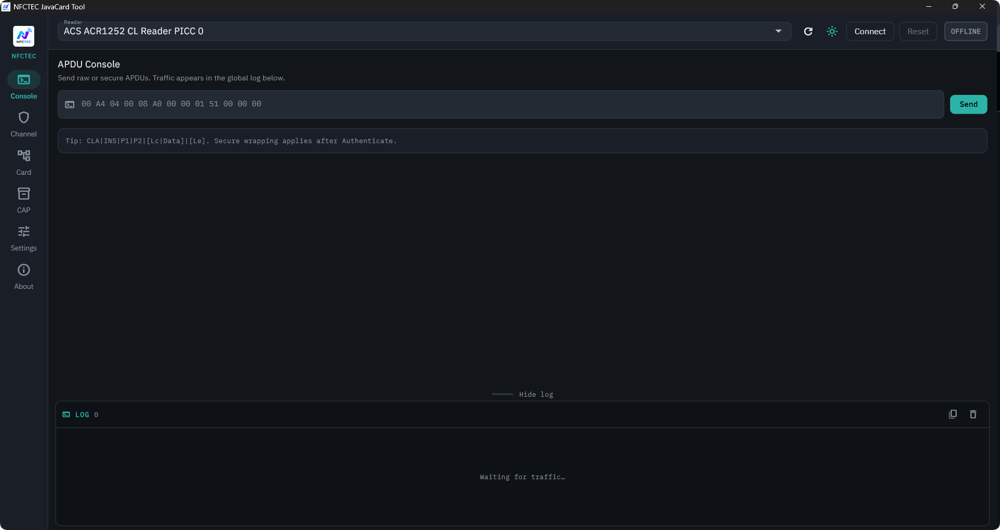
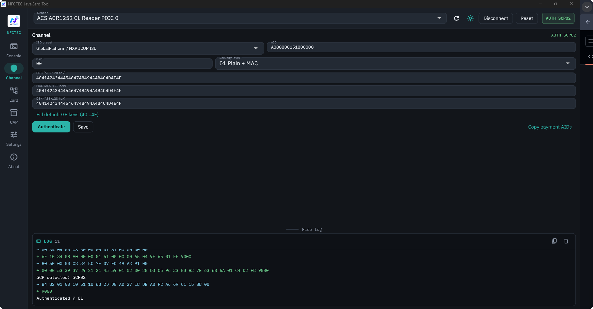
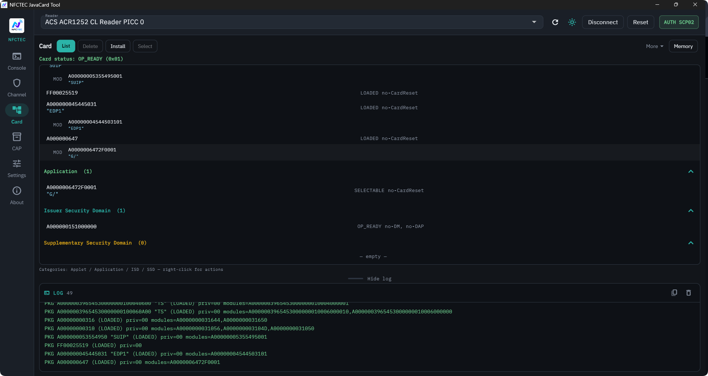

**[English](README.md)** · **[中文](README.zh-CN.md)**

**[www.nfctec.com](https://www.nfctec.com)** — NFCTEC NFC & smart card software, hardware and cloud.

# JavaCard GlobalPlatform Tool — CAP Load, SCP02/SCP03, APDU

Windows and macOS **Java Card** / **GlobalPlatform** host for **NXP JCOP**, ACOS and other GP cards: **SCP02 / SCP03** secure channel, **CAP load** / INSTALL, **CPLC** readout, card registry (GET STATUS), Put Key, and an **APDU** console over PC/SC.

- Website: [https://www.nfctec.com](https://www.nfctec.com)
- Product: [JavaCard Tool](https://www.nfctec.com/en/tools/javacard-tool)
- **Download (Windows x64 & macOS):** [https://nfctec.com/en/downloads](https://nfctec.com/en/downloads)

Authenticate to the Issuer Security Domain, list applets, drop a `.cap` to load, then debug APDU traces — one bench tool instead of a GP shell plus a separate CAP loader.

## Download

| Platform | File | Link |
| --- | --- | --- |
| Windows x64 | NFCTEC-JavaCard-TOOL | [Download Center](https://nfctec.com/en/downloads) |
| macOS | NFCTEC-JavaCard-Tool-macOS | [Download Center](https://nfctec.com/en/downloads) |

Works with PC/SC USB CCID readers (ACS ACR122U / ACR1252, Identiv, HID Omnikey, Feitian, contact and contactless ISO 7816 / ISO 14443).

This GitHub page is documentation and screenshots only. Installers are not hosted here — get them from [www.nfctec.com](https://www.nfctec.com).

## Features

**Secure channel (SCP02 / SCP03)**  
INITIALIZE UPDATE / EXTERNAL AUTHENTICATE with ENC / MAC / DEK. Auto-detect SCP02 (3DES, i=15) or SCP03 (AES-CMAC). Security level: `00` Plain, `01` Plain + MAC, `03` ENC + MAC. ISD presets: GlobalPlatform / NXP JCOP `A000000151000000`, Visa, Mastercard, Gemalto, Oberthur / Idemia.

**CAP load & INSTALL**  
Drag-and-drop Java Card `.cap`. Parse package AID / module AID, then DELETE → INSTALL [for load] → LOAD in blocks → optional INSTALL [for install]. Invalid CAP (no `Header.cap`) is rejected before the card sees it.

**Card registry & CPLC**  
GET STATUS list: packages, applets, applications, ISD, SSD. Select, Delete, Lock / Unlock, Install. Card Info parses GET DATA `9F7F` CPLC (IC fabricator, OS, serial). Put Key, Store Data, lifecycle, free-memory probe.

**APDU console**  
Hex APDU send/receive, history, auto GET RESPONSE (`61xx` / `6Cxx`). After AUTH, wrapping follows the current SCP security level. Live log for `6982` / `6985` / `6A82` / `6A86` bring-up.

Lab default keys `4041…4E4F` only. Production ISD keys stay on [www.nfctec.com](https://www.nfctec.com) projects.

## Screenshots

APDU console — send hex commands with a live log:

SCP02/SCP03 channel — ISD, ENC/MAC/DEK, Authenticate:

Card registry — GET STATUS applets, ISD, SSD:

## Related products

From [www.nfctec.com](https://www.nfctec.com): **JavaCard JCOP** applets, NTAG 424 DNA / DNA TT (NT4H2421Gx), MIFARE DESFire EV2/EV3, USB/CCID readers, issuance workbench, and HSM-backed cloud.

[Download Center](https://nfctec.com/en/downloads) also has **NTAG424 DNA Tool** and **Issuance Workbench**.

## About NFCTEC

[NFCTEC](https://www.nfctec.com) — Shenzhen NFC factory: JavaCard / GlobalPlatform tools, encoding software, USB/CCID readers, antennas, PVC / wet inlay / wristband, HSM-backed issuance.

[www.nfctec.com](https://www.nfctec.com) · [Downloads](https://nfctec.com/en/downloads) · [JavaCard Tool](https://www.nfctec.com/en/tools/javacard-tool)
