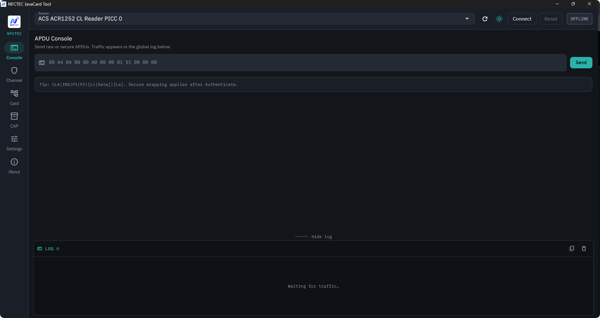
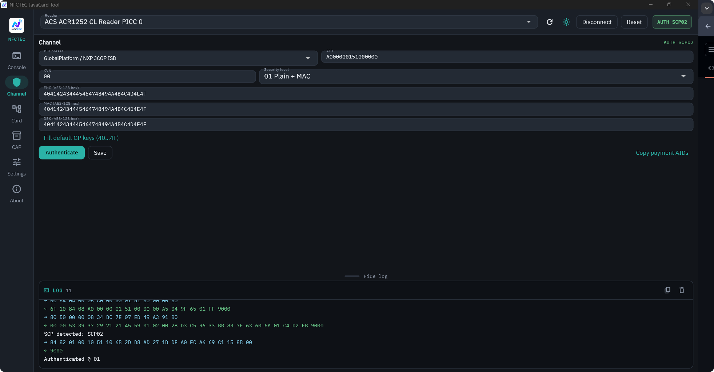
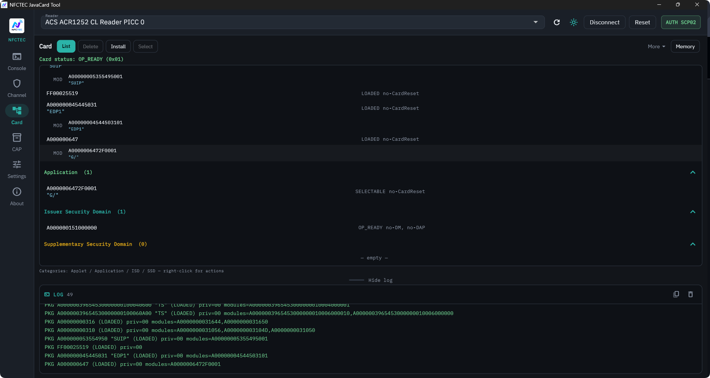

**[English](README.md)** · **[中文](README.zh-CN.md)**

**[www.nfctec.com](https://www.nfctec.com)** — NFCTEC NFC 与智能卡软件、硬件与云服务。

# JavaCard GlobalPlatform 工具 — CAP 下载、SCP02/SCP03、APDU

Windows / macOS 上的 **Java Card** / **GlobalPlatform** 主机工具，面向 **NXP JCOP**、ACOS 等 GP 卡：**SCP02 / SCP03** 安全通道、**CAP 下载** / INSTALL、**CPLC** 解析、卡片注册表（GET STATUS）、Put Key、PC/SC **APDU** 控制台。

- 官网：[https://www.nfctec.com](https://www.nfctec.com)
- 产品页：[JavaCard Tool](https://www.nfctec.com/en/tools/javacard-tool)
- **下载（Windows x64 与 macOS）：** [https://nfctec.com/en/downloads](https://nfctec.com/en/downloads)

对 Issuer Security Domain 认证、列出 applet、拖入 `.cap` 下载，再在同一窗口调试 APDU，不必再拆开 GP 命令行和 CAP 加载器。

## 下载

| 平台 | 文件 | 链接 |
| --- | --- | --- |
| Windows x64 | NFCTEC-JavaCard-TOOL | [下载中心](https://nfctec.com/en/downloads) |
| macOS | NFCTEC-JavaCard-Tool-macOS | [下载中心](https://nfctec.com/en/downloads) |

支持 PC/SC USB CCID 读卡器（ACS ACR122U / ACR1252、Identiv、HID Omnikey、飞天等接触 / 非接触 ISO 7816 / ISO 14443）。

本仓库只放说明和截图，安装包不在 GitHub。请到 [www.nfctec.com](https://www.nfctec.com) 下载。

## 功能

**安全通道（SCP02 / SCP03）**  
INITIALIZE UPDATE / EXTERNAL AUTHENTICATE，ENC / MAC / DEK。自动识别 SCP02（3DES，i=15）或 SCP03（AES-CMAC）。安全级别：`00` Plain、`01` Plain + MAC、`03` ENC + MAC。ISD 预设：GlobalPlatform / NXP JCOP `A000000151000000`、Visa、Mastercard、Gemalto、Oberthur / Idemia。

**CAP 下载与 INSTALL**  
拖放 Java Card `.cap`。解析 package AID / module AID，再 DELETE → INSTALL [for load] → 分块 LOAD → 可选 INSTALL [for install]。无效 CAP（没有 `Header.cap`）在下卡前拒绝。

**卡片注册表与 CPLC**  
GET STATUS：package、applet、application、ISD、SSD。Select、Delete、Lock / Unlock、Install。Card Info 解析 GET DATA `9F7F` CPLC。Put Key、Store Data、生命周期、空闲内存探测。

**APDU 控制台**  
十六进制收发、历史、自动 GET RESPONSE（`61xx` / `6Cxx`）。认证后按当前 SCP 级别封装。日志便于排查 `6982` / `6985` / `6A82` / `6A86`。

实验室默认密钥 `4041…4E4F` 仅用于样卡。量产 ISD 密钥走 [www.nfctec.com](https://www.nfctec.com) 项目。

## 截图

APDU 控制台 — 发送十六进制命令与实时日志：

SCP02/SCP03 通道 — ISD、ENC/MAC/DEK、Authenticate：

卡片注册表 — GET STATUS applet、ISD、SSD：

## 相关产品

[www.nfctec.com](https://www.nfctec.com)：**JavaCard JCOP** 应用、NTAG 424 DNA / DNA TT（NT4H2421Gx）、MIFARE DESFire EV2/EV3、USB/CCID 读卡器、发卡工作台、HSM 云端。

[下载中心](https://nfctec.com/en/downloads) 另有 **NTAG424 DNA Tool** 与 **Issuance Workbench**。

## 关于 NFCTEC

[NFCTEC](https://www.nfctec.com) — 深圳 NFC 工厂：JavaCard / GlobalPlatform 工具、编码软件、USB/CCID 读卡器、天线、PVC / 湿 inlay / 腕带、HSM 发卡。

[www.nfctec.com](https://www.nfctec.com) · [下载](https://nfctec.com/en/downloads) · [JavaCard Tool](https://www.nfctec.com/en/tools/javacard-tool)
